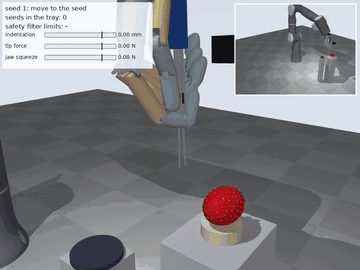

# Safe, Gentle Seed Removal from Strawberries (simulation)

Course project for EN.601.497/697 Human-Centered Robotics (Fall 2026).
Team: Kai Hua Liu, Zijun Xiang, Zixuan Zhu.

A 7-joint robot arm carries a Wuji Hand 2. The hand holds a pair of tweezers and squeezes them
with thumb and index finger. The robot finds strawberry seeds with a wrist camera, pulls them
out one by one and drops them in a tray, while a safety filter keeps the contact with the fruit
inside a damage limit ("safe set").

Everything here runs in simulation (MuJoCo). Nothing has been run on a real robot.



**Start with [`report/REPORT.md`](report/REPORT.md)** (also as `report/REPORT.pdf`): it walks
through every step with screenshots and gives all results. The full demo video is
`demo/seed_removal_demo.mp4`.

## Results in short

64 seeds per condition (8 random berries, 8 seeds each), simulation only.

| Condition | Seeds removed | Seeds with a safe-set violation |
|---|---|---|
| Camera depth only, no filter | 86% | 27% |
| Touch-referenced planner, no filter | 100% | 0% |
| Touch-referenced planner + safety filter | 100% | 0% |
| Mis-tuned planner, no filter | 67% | 100% |
| Mis-tuned planner + safety filter | 89% | 2% |
| Simulated person steers everything, no filter | 78% | 66% |
| Simulated person steers everything + filter | 27% | 6% |
| Person steers sideways, robot controls depth, + filter | 100% | 0% |
| Shifted simulation, simulation calibration only | 97% | 19% |
| Shifted simulation, full on-site calibration | 80% | 2% |

The report explains each row, including the ones that did not work.

## Install

Python 3.10 or newer.

```bash
pip install -r requirements.txt
```

## Run

```bash
python -m pytest -q tests                 # 12 tests, about half a minute
python scripts/make_demo.py               # records demo/seed_removal_demo.mp4
python scripts/teleop_keyboard.py         # drive the tweezers yourself in the MuJoCo viewer
python scripts/run_experiments.py all     # all experiments (about 1 hour on 2 cores)
python scripts/run_stress.py              # mis-tuned planner with / without the filter, margin sweep
python scripts/run_transfer_fix.py        # shifted domain: surface re-referencing and new bounds
python scripts/make_figures.py            # figures and tables from results/*.json
python scripts/make_report_assets.py      # step-by-step screenshots of the report
python scripts/make_report.py             # writes report/REPORT.md from the results
python scripts/make_report_pdf.py         # report/REPORT.pdf (needs pandoc and Chrome)
```

On Windows and macOS, rendering works out of the box. On a headless Linux machine it needs EGL;
without it the code still runs and the camera falls back to a geometric model.

Use a few lines of Python:

```python
from seedsafe.runner import run_berry
out = run_berry(seed=7, mode="filtered", max_seeds=5)   # one berry, five seeds
print(out["summary"])
```

Modes: `open_loop`, `touch`, `filtered` (the proposed system), `teleop`, `teleop_filtered`,
`shared_filtered`.

## What is in the repository

| Path | Content |
|---|---|
| `seedsafe/scene.py` | builds the MuJoCo scene: arm + Wuji Hand 2 + tweezers + berry + cameras |
| `seedsafe/env.py` | simulation loop, arm and finger control, sensors |
| `seedsafe/contact.py` | tip-flesh and tip-seed contact, seed pull-out, damage measure |
| `seedsafe/hand.py` | tweezer calibration: jaw gap and squeeze force from the fingers |
| `seedsafe/perception.py` | seed localization with the wrist camera |
| `seedsafe/conformal.py` | conformal prediction bounds on the estimate errors |
| `seedsafe/estimation.py` | touch detection, indentation and force estimates |
| `seedsafe/ilqr.py`, `seedsafe/planner.py` | nominal planner (iLQR-based MPC + phase machine) |
| `seedsafe/safety.py` | safety filter (control barrier functions as a small QP, reachability-based approach speed) |
| `seedsafe/operator.py` | simulated human operator and shared control |
| `seedsafe/calib.py` | on-site calibration: force-noise check, stiffness probe, new bounds |
| `seedsafe/runner.py` | runs episodes and scores them against the safe set |
| `scripts/` | experiments, figures, demo, keyboard teleoperation, grasp design |
| `tests/` | unit and system tests |
| `results/` | raw experiment results (JSON) |
| `report/` | the report, its figures and step-by-step screenshots |
| `assets/` | robot models (see `THIRD_PARTY.md`) and the grasp table |

## Simplifications to know about

- The arm is a Flexiv Rizon 4 model, standing in for the Flexiv Enlight (no public Enlight model).
- The hand is the maker's public Wuji Hand model; it was not checked against the second-generation hardware.
- The tweezer sleeve is held in the hand by a friction-limited seat (it slips when overloaded);
  thumb and index press the tweezer arms through real simulated contacts.
- The fruit is a rigid ellipsoid on a soft cradle with a compliant contact law at the two tips
  (indentation and force are the quantities the safe set is defined on); it is not a finite-element body.
- The human operator in the shared-control experiment is a simulated model, not a person.
- "Sim-to-real" is studied as transfer to a second, shifted simulation. No hardware was used.
