# Safe, Gentle Seed Removal from Strawberries: simulation report

*EN.601.497/697 Human-Centered Robotics, Fall 2026. Team: Kai Hua Liu, Zijun Xiang, Zixuan Zhu.*

This report documents the simulation part of the project, step by step, with a screenshot for
every step. Every image and number below is produced by the code in this repository
(`scripts/make_report_assets.py`, `scripts/run_experiments.py`, `scripts/make_figures.py`,
`scripts/make_report.py`). Nothing was run on a real robot.

## Summary

A 7-joint arm carries a Wuji Hand 2. The hand holds tweezers and closes them with thumb and
index finger. A wrist camera finds the seeds, a nominal planner removes them one by one, and a
safety filter overrides commands that would leave the safe set. All results are over
8 random berries per condition, 8 target seeds each (64 seeds per condition).

| Question from the proposal | Short answer from the simulation |
|---|---|
| 1. Safe set: can a filter keep the arm and hand inside it? | Yes, in the nominal simulation. With the filter 0% of seeds had a violation and 100% were removed. A planner mis-tuned to press too deep and approach too fast violated the safe set on 100% of seeds; behind the filter the same planner violated it on 2% and removed 89% (without the filter: 67%). |
| 2. Tool use: can the hand hold and squeeze the tweezers, and what can it sense? | Thumb and index close the jaws through contact. From finger encoders alone the jaw gap is known to 0.06 mm (rms). From fingertip force the squeeze on a 1 mm object is known to 0.014 N (rms). |
| 3. Uncertainty: how conservative must the filter be? | With the well-tuned planner the margins made no difference: 0% violations at every setting. They matter when a mis-tuned planner makes the filter decide the depth. Violations then: 48% with no margins, 25% with 50% conformal bounds, 2% with 90% bounds, 0% with 99% bounds (100% of seeds removed). Three times the 99% bounds was too conservative: 0% removed. |
| 4. Shared control: how to split authority? | Person picks the seed and steers sideways, robot controls depth and gripping, filter on: 100% removed, 0% with a violation, 10.0 s per seed. Person steering everything: 78% removed, 66% with a violation, 11.3 s per seed without the filter, 27% removed, 6% with a violation, 21.1 s per seed with it. |
| 5. Sim-to-real: does the simulation-calibrated safe set transfer? | Only tested against a second, shifted simulation (softer fruit, noisier sensors), not on hardware. Not as it is: with the simulation calibration 19% of seeds had a violation (97% removed). Partial on-site calibration made the robot too cautious to grip (30% and 3% removed). With the full on-site calibration: 80% removed, 2% with a violation. |

Main limits of this work are listed at the end. The most important ones: the fruit is not a
finite-element body, the human operator is a model, and "sim-to-real" has not touched hardware.

## What from the proposal is implemented

| Proposal item | Status | Where |
|---|---|---|
| MuJoCo scene: arm, Wuji Hand 2, tweezers, compliant berry, seed targets | done | `seedsafe/scene.py`, `seedsafe/env.py` |
| Force and indentation damage measure | done | `seedsafe/contact.py` |
| Scripted grasp that holds the tweezers and closes the jaws | done | `scripts/design_grasp.py`, `seedsafe/hand.py` |
| Nominal planner for arm and fingers | done (iLQR-based MPC) | `seedsafe/ilqr.py`, `seedsafe/planner.py` |
| Safety filter | done (CBF constraints in a QP, reachability-based approach speed) | `seedsafe/safety.py` |
| Seed localization with uncertainty bounds | done (wrist camera + conformal prediction) | `seedsafe/perception.py`, `seedsafe/conformal.py` |
| Tweezer pose and tip-force estimation from the finger joints | done | `seedsafe/hand.py`, `seedsafe/estimation.py` |
| Experiments against an unfiltered baseline | done | `scripts/run_experiments.py` |
| Human operator, shared autonomy | done with a simulated operator; a keyboard teleoperation script exists for real people | `seedsafe/operator.py`, `scripts/teleop_keyboard.py` |
| Calibrate the tweezer grasp away from the berry | done in simulation | `seedsafe/hand.py` |
| Port to the physical arm, proxy berry, real strawberries | not done (simulation only, as agreed) | |

Abbreviations used below, with their full names:
MPC (Model Predictive Control, 模型预测控制), iLQR (iterative Linear Quadratic Regulator, 迭代线性二次型调节器),
CBF (Control Barrier Function, 控制屏障函数), QP (Quadratic Program, 二次规划), DoF (Degrees of Freedom, 自由度),
MJCF (MuJoCo XML model Format, MuJoCo 模型文件格式), rms (root mean square, 均方根).
A glossary of the technical terms (English / 中文) is at the end.

---

## Step 1. The scene

**What was done.** The official Wuji Hand model (20 DoF) is mounted on a Flexiv Rizon 4 arm
model (7 DoF) through an angled adapter. The Rizon 4 stands in for the Flexiv Enlight because no
public Enlight model exists. A pair of tweezers (two elastic arms joined at the base, 140 mm
long) sits in the hand. A strawberry with about 200 seeds rests on a soft cradle; a tray takes
the removed seeds. The model has 38 position coordinates and 27 motors.

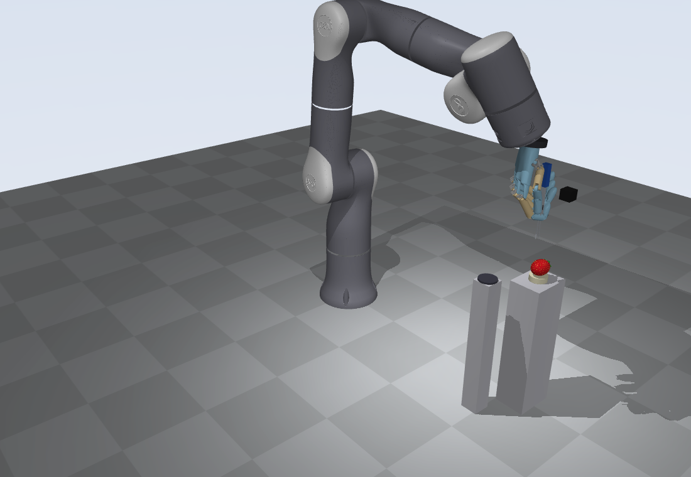

The hand holding the tweezers, from two sides. Thumb and index finger pinch the two tweezer
arms. The other three fingers wrap the printed sleeve (blue). The black box is the wrist camera.

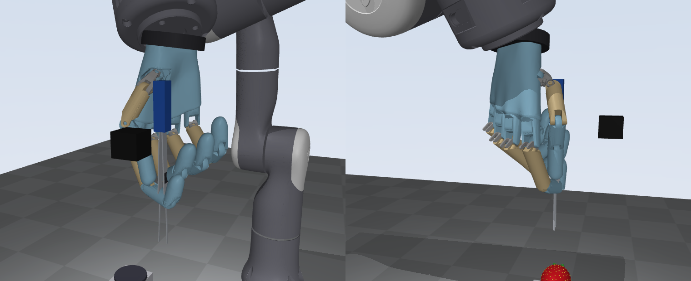

Left: the berry. Right: what the wrist camera sees from its survey position.

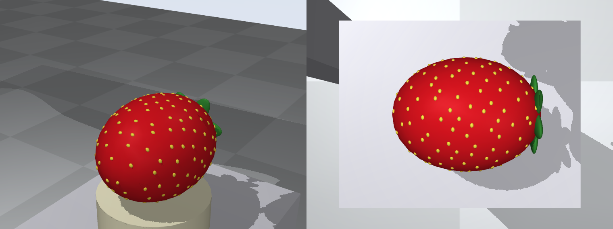

Modelling choices that matter:

- **Fingers on the tweezers.** Thumb and index press the tweezer arms through simulated contacts.
  The pinch pose and a table "closure command c -> finger joint targets" are designed once by
  `scripts/design_grasp.py`. The stock finger position gains are very soft, so the two pinching
  fingers use higher gains, and the thumb is made as stiff as the index along the pinch axis.
- **Sleeve in the hand.** The sleeve is held by a stiff seat that slips when the load exceeds
  the grip friction (6 N or 0.15 N m). Slip stays; the robot does not see it. This is the "tool
  must not slip" part of the safe set.
- **Arm.** Position-controlled joints with a task-space controller on top. The stock position
  gains of the arm model (about 1.5 Hz) are raised to about 6 Hz.

## Step 2. Tweezer calibration (away from the berry)

**What was done.** This is the first hardware step of the proposal, done here in simulation.
Two sweeps, run once per session:

1. *Free sweep.* Close the empty jaws slowly. Record the jaw gap and the thumb-index distance
   computed from the finger encoders. The jaws meet at closure c = 0.48.
2. *Gauge sweep.* Close on a rigid 1 mm ball and record the squeeze force.

After that the robot estimates the jaw gap from finger encoders (rms error 0.059 mm) and
the squeeze force from the fingertip force sensors (rms error 0.014 N on the gauge).
The sweep also showed that the two arms do not close evenly: the midpoint between the tips
drifts sideways by up to 0.42 mm. That drift is stored and compensated. Without the
compensation the tips landed next to the seeds.

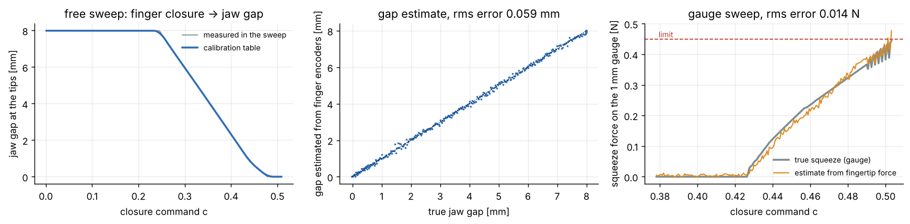

Reproduce: `python scripts/make_report_assets.py calibration`

## Step 3. Contact model, safe set and damage measure

**What was done.** MuJoCo simulates the arm, the hand, the tweezers and the finger contacts.
The millimetre-scale contact at the two tweezer tips is computed by `seedsafe/contact.py`,
because the safe set is defined on exactly these quantities:

- *tip on flesh*: normal force `F = k * depth^1.5` (a Hertz-type law with damping) plus a shear
  spring that slides at the friction limit;
- *tip on seed*: stiff contact against a 1 mm sphere; the tips are flat pads 1.2 mm wide;
- *seed in its pit*: a spring that lets go at the pull-out force (about 0.08 N). The seed centre
  sits 0.35 mm below the surface, so the tips must press slightly into the flesh to grip it.

**Safe set** (per seed, judged on ground truth):

| Quantity | Limit |
|---|---|
| tip indentation | 0.6 mm |
| normal force per tip | 0.15 N |
| shear force per tip | 0.08 N |
| jaw squeeze on the seed | 0.45 N |
| tool slip inside the hand | 0.4 mm |

Indentation beyond 1.0 mm or force beyond 0.3 N counts as *visible damage*.

The figure shows the contact law (left) and what the same bad command does without and with
the safety filter (middle, right): "push 2 mm into the berry at 4 mm/s". Without the filter the
tips went 2.7 mm deep (7.9 N). With the filter they stopped at
0.46 mm (0.09 N).

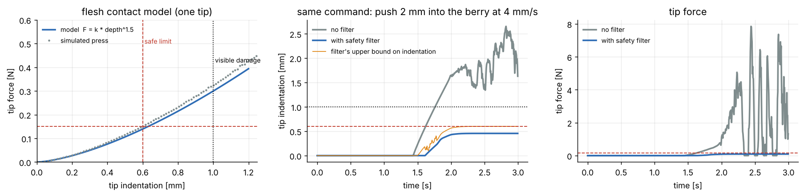

Reproduce: `python scripts/make_report_assets.py contact`

## Step 4. Seed localization with the wrist camera

**What was done.** The camera moves about 10 cm above the berry and takes one colour and one
depth image. Yellow blobs are seeds. For each seed the flesh around it gives the surface point
and the surface normal. Modelled error sources: pixel size, depth noise, hand-eye calibration
error, shading.

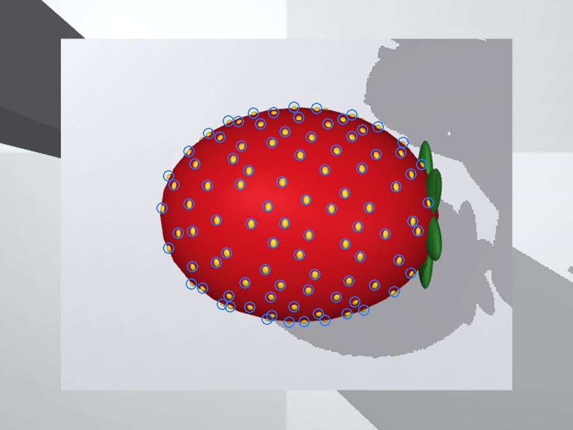

On 12 random berries (156 seeds): sideways error 0.22 mm on average
(0.31 mm at the 90th percentile), surface height error +0.12 mm on average
(0.24 mm at the 90th percentile), normal direction error 1.1 degrees.
The height error has a bias: the camera places the surface a little too low.

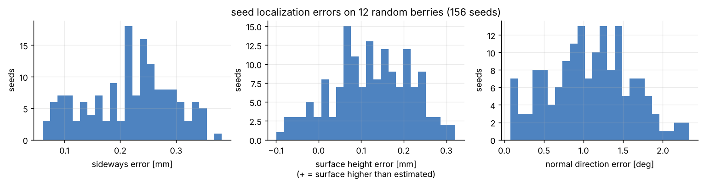

Only the seeds inside a fixed patch on top of the berry are physically simulated and targeted
(the proposal's "fixed patch of seeds").

Reproduce: `python scripts/make_report_assets.py perception`

## Step 5. Nominal planner and one seed from start to finish

**What was done.** The planner is a phase machine: move above the seed, descend, close the jaws,
pull, carry to the tray, release. Inside each phase the motion comes from MPC: an iLQR solver
plans 0.5 s ahead on a small model (tip position and jaw closure), 50 times per second, with
costs for reaching the goal, speed limits and staying clear of the berry between seeds.

The planner does not know the safe set. Two details make it gentle anyway:

- *Touch-referenced depth.* The camera's surface height is not accurate enough
  (Step 4). The planner descends slowly until the force estimate reports touch, and measures
  the gripping depth from there.
- *Force estimate.* Tip force is estimated from the arm's joint torque sensors and zeroed in
  free space before each descent.

The timeline below shows one seed with the filtered system: 7.4 s, peak
indentation 0.36 mm, peak tip force 0.063 N, peak squeeze 0.31 N.
Blue is ground truth, grey is what the robot estimates, orange is the upper bound the filter uses.

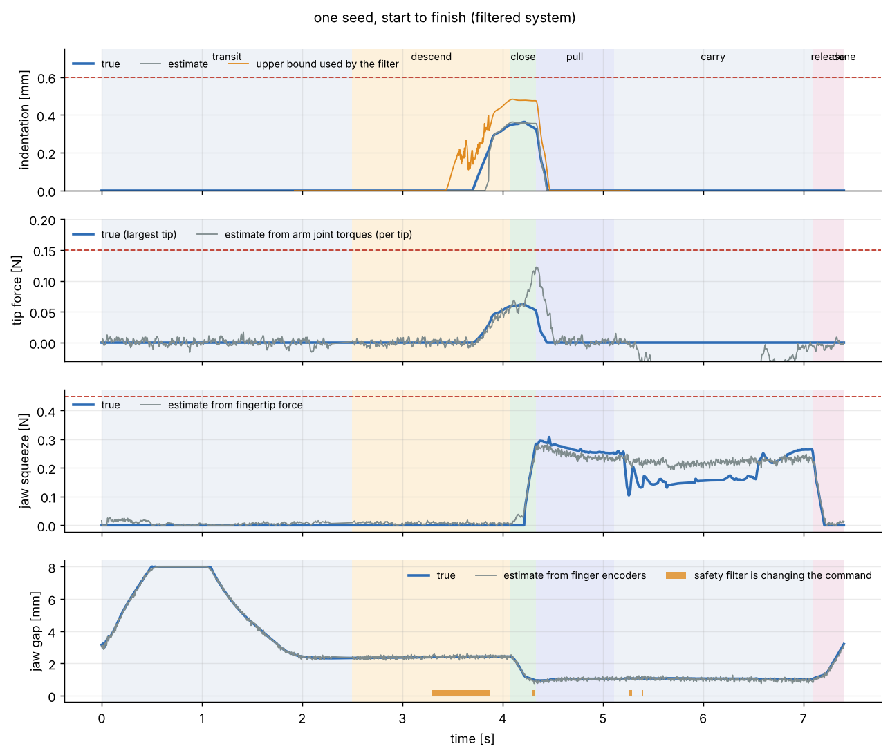

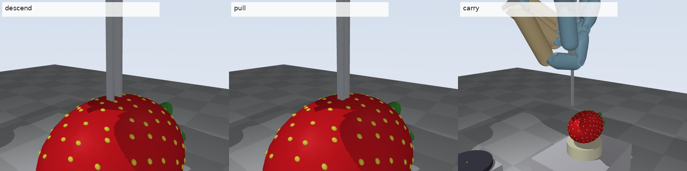

Reproduce: `python scripts/make_report_assets.py single`

## Step 6. Safety filter

**What was done.** The filter sits between the planner (or the human) and the robot. Every
5 ms it solves a small QP: stay as close as possible to the commanded tip velocity and jaw
closing rate, subject to one CBF constraint per limit of the safe set.

| Constraint | Uses | Effect |
|---|---|---|
| indentation | upper bound on indentation (kinematics + touch, capped by what the measured force allows) | slows and stops the descent |
| normal force | force estimate + error bound, upper bound on flesh stiffness | slows, stops, or backs off |
| approach speed | distance to where contact becomes possible | tip arrives slowly enough to stop on touch |
| drag | "contact possible" flag | limits sideways motion while touching |
| grip stability | sideways force estimate vs. what the sleeve grip can hold | prevents tool slip |
| jaw squeeze | squeeze estimate + error bound | limits jaw closing |

The approach-speed limit is the boundary of a reachable set: the largest speed from which the
tip can still slow down to touch speed before contact becomes possible, given a reaction delay
and a braking limit. The figure shows the set computed on a grid and the closed-form boundary
the filter uses.

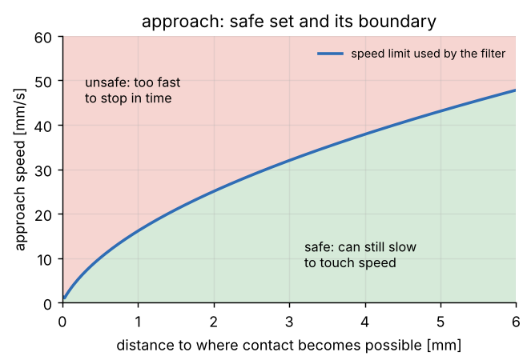

## Step 7. Uncertainty bounds from conformal prediction

**What was done.** The filter needs error bounds for its estimates. They come from split
conformal prediction: run calibration berries, record the errors against ground truth, and take
the quantile that gives the wanted coverage. 80 seeds on 10 calibration
berries were used. At 90% coverage the bounds are: surface height before touch
0.67 mm, indentation after touch 0.10 mm, sideways seed position
0.44 mm, tip force 0.049 N, squeeze 0.078 N.

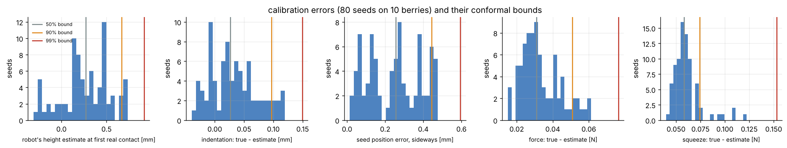

The sideways bound also sets how far the jaws are opened before descending, so that the seed is
surely between the tips.

---

## Step 8. Experiments

Each condition: 8 random berries (size, stiffness, seed layout, pull-out force, sensor
biases and calibration errors all vary), 8 target seeds per berry. "Violation" means that at
least one limit of the safe set was exceeded while working on that seed. Error bars are 95%
Wilson intervals.

### E1. Filtered system against unfiltered baselines

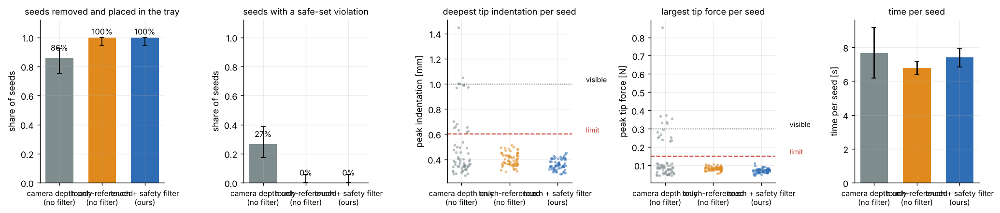

| condition | seeds | removed | any violation | indent | force | shear | squeeze | slip | visible damage | time / seed [s] | attempts | filter intervention |
|---|---|---|---|---|---|---|---|---|---|---|---|---|
| camera depth only (no filter) | 64 | 86% | 27% | 25% | 25% | 25% | 14% | 0% | 13 | 7.7 | 1.34 | 0% |
| touch-referenced (no filter) | 64 | 100% | 0% | 0% | 0% | 0% | 0% | 0% | 0 | 6.8 | 1.00 | 0% |
| touch + safety filter (ours) | 64 | 100% | 0% | 0% | 0% | 0% | 0% | 0% | 0 | 7.4 | 1.02 | 1% |

Findings:

- **Camera depth only, no filter:** 86% removed, 27% with a violation, 7.7 s per seed; 13 spots with visible damage. Relying on
  the camera for depth is not good enough.
- **Touch-referenced depth, no filter:** 100% removed, 0% with a violation, 6.8 s per seed. With a well-tuned planner and nominal
  conditions the planner alone stayed inside the safe set.
- **With the safety filter:** 100% removed, 0% with a violation, 7.4 s per seed. The filter changed 1% of the commanded
  motion and cost 7.4 s instead of 6.8 s per seed. No seeds were lost
  to the filter.

So in nominal conditions the filter is not what makes the system gentle; the touch-referenced
planner already is. The filter matters when the command is wrong, which the next test shows.

### E1b. A badly tuned planner, with and without the filter

The planner is told to go twice as deep (0.8 mm instead of 0.4 mm) and to approach four times
faster (16 mm/s instead of 4 mm/s) than it should.

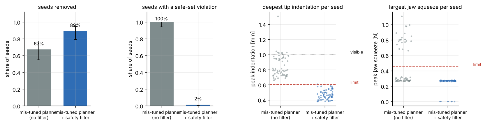

| condition | seeds | removed | any violation | indent | force | shear | squeeze | slip | visible damage | time / seed [s] | attempts | filter intervention |
|---|---|---|---|---|---|---|---|---|---|---|---|---|
| mis-tuned planner (no filter) | 64 | 67% | 100% | 100% | 100% | 100% | 34% | 0% | 33 | 6.3 | 1.33 | 0% |
| mis-tuned planner + safety filter | 64 | 89% | 2% | 2% | 0% | 0% | 0% | 0% | 0 | 10.4 | 1.17 | 7% |

Without the filter: 100% of seeds with a violation, deepest indentation
1.51 mm, 33 spots with visible damage, 67% of seeds removed
(pressing too deep also makes the tips miss seeds). Behind the filter, with the 90% bounds:
2% of seeds with a violation (1 of 64), deepest indentation
0.61 mm against the limit of 0.6 mm, no visible damage,
89% of seeds removed. The filter changed 7% of the commanded motion and the
time per seed went from 6.3 s to 10.4 s.

So the filter turned a planner that damages every seed site into one that almost never leaves
the safe set. It is not a guarantee: one seed in this test went slightly past the limit.

### E2. How conservative must the filter be?

The same system with uncertainty margins from conformal bounds at different coverage levels,
and with no margins at all.

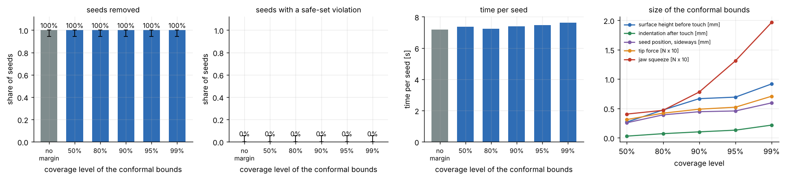

| condition | seeds | removed | any violation | indent | force | shear | squeeze | slip | visible damage | time / seed [s] | attempts | filter intervention |
|---|---|---|---|---|---|---|---|---|---|---|---|---|
| no margin | 64 | 100% | 0% | 0% | 0% | 0% | 0% | 0% | 0 | 7.2 | 1.05 | 1% |
| 50% | 64 | 100% | 0% | 0% | 0% | 0% | 0% | 0% | 0 | 7.4 | 1.08 | 1% |
| 80% | 64 | 100% | 0% | 0% | 0% | 0% | 0% | 0% | 0 | 7.2 | 1.00 | 1% |
| 90% | 64 | 100% | 0% | 0% | 0% | 0% | 0% | 0% | 0 | 7.4 | 1.02 | 1% |
| 95% | 64 | 100% | 0% | 0% | 0% | 0% | 0% | 0% | 0 | 7.5 | 1.03 | 1% |
| 99% | 64 | 100% | 0% | 0% | 0% | 0% | 0% | 0% | 0 | 7.6 | 1.02 | 2% |

Bounds used:

| coverage | surface [mm] | indentation [mm] | sideways [mm] | force [N] | squeeze [N] |
|---|---|---|---|---|---|
| 50% | 0.27 | 0.03 | 0.26 | 0.031 | 0.040 |
| 80% | 0.47 | 0.07 | 0.39 | 0.042 | 0.047 |
| 90% | 0.67 | 0.10 | 0.44 | 0.049 | 0.078 |
| 95% | 0.69 | 0.13 | 0.46 | 0.052 | 0.131 |
| 99% | 0.92 | 0.22 | 0.59 | 0.071 | 0.196 |

Coverage of the bounds on the test berries (they were calibrated on other berries):

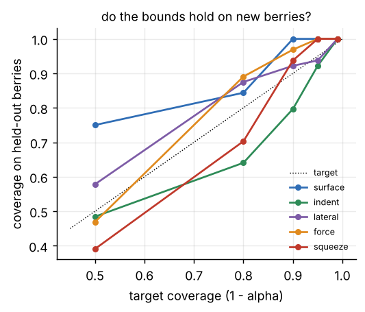

Findings with the well-tuned planner:

- No margins: 100% removed, 0% with a violation, 7.2 s per seed. 50% bounds: 100% removed, 0% with a violation, 7.4 s per seed. 90% bounds: 100% removed, 0% with a violation, 7.4 s per seed. 99% bounds: 100% removed, 0% with a violation, 7.6 s per seed.
- Nothing changes except a little time. The reason is E1: the well-tuned planner is already
  gentle, so the filter rarely acts and its margins hardly matter.

To see what the margins do, the same sweep was repeated with the mis-tuned planner of E1b. Now
the planner always asks for too much, and the filter decides how deep the tips go.

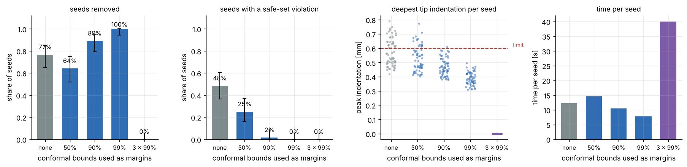

| condition | seeds | removed | any violation | indent | force | shear | squeeze | slip | visible damage | time / seed [s] | attempts | filter intervention |
|---|---|---|---|---|---|---|---|---|---|---|---|---|
| no margins | 64 | 77% | 48% | 44% | 12% | 3% | 0% | 0% | 5 | 12.3 | 1.30 | 7% |
| 50% bounds | 64 | 64% | 25% | 25% | 5% | 5% | 0% | 0% | 11 | 14.6 | 1.42 | 12% |
| 90% bounds | 64 | 89% | 2% | 2% | 0% | 0% | 0% | 0% | 0 | 10.4 | 1.17 | 7% |
| 99% bounds | 64 | 100% | 0% | 0% | 0% | 0% | 0% | 0% | 0 | 7.8 | 1.00 | 5% |
| 3 x the 99% bounds | 64 | 0% | 0% | 0% | 0% | 0% | 0% | 0% | 0 | 40.0 | 1.00 | 0% |

Findings when the filter decides the depth:

- **No margins:** 77% removed, 48% with a violation, 12.3 s per seed. The filter trusts its estimates exactly, and the estimates are a
  little off, so the tips often end up beyond the limit.
- **50% bounds:** 64% removed, 25% with a violation, 14.6 s per seed.
- **90% bounds:** 89% removed, 2% with a violation, 10.4 s per seed.
- **99% bounds:** 100% removed, 0% with a violation, 7.8 s per seed. This was the best setting in this test.
- **Three times the 99% bounds:** 0% removed, 0% with a violation, 40.0 s per seed. The force margin alone (0.21 N) is then
  larger than the force limit (0.15 N), so the filter never allows contact and every
  seed runs into the 40 s time limit.

Two cautions for reading the seed-removal numbers. First, the sideways bound also sets how far
the jaws open before the descent. The 50% setting opens them less (0.26 mm bound
instead of 0.59 mm at 99%), which by itself causes more misses. Second, each setting
has 64 seeds on 8 berries, and failures cluster on single berries, so differences of 10 to 15
percentage points in removal between neighbouring settings are within the noise. The trend in
violations (from 48% down to 0%) is the reliable part.

### E3. Shared control: who commands what?

A simulated person steers the tip with a joystick model: reaction delay 0.2 s, tremor, motor
noise, and depth judgement that is off by about 0.45 mm (standard deviation). Gripping is
always automatic after the person presses "grip".

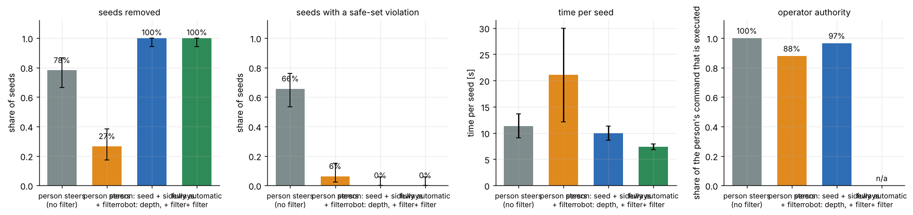

| condition | seeds | removed | any violation | indent | force | shear | squeeze | slip | visible damage | time / seed [s] | attempts | operator authority |
|---|---|---|---|---|---|---|---|---|---|---|---|---|
| person steers (no filter) | 64 | 78% | 66% | 64% | 59% | 55% | 6% | 0% | 82 | 11.3 | 1.45 | 100% |
| person steers + filter | 64 | 27% | 6% | 2% | 6% | 6% | 0% | 0% | 3 | 21.1 | 1.77 | 88% |
| person: seed + sideways robot: depth, + filter | 64 | 100% | 0% | 0% | 0% | 0% | 0% | 0% | 0 | 10.0 | 1.08 | 97% |
| fully automatic + filter | 64 | 100% | 0% | 0% | 0% | 0% | 0% | 0% | 0 | 7.4 | 1.02 | n/a |

Findings:

- **Person steers everything, no filter:** 78% removed, 66% with a violation, 11.3 s per seed; 82 spots with visible damage. People
  judge depth poorly, so they press too deep.
- **Person steers everything, with filter:** 27% removed, 6% with a violation, 21.1 s per seed; 3 spots with visible damage.
  Violations drop from 66% to 6%, and 88% of the person's command is
  executed, but most seeds are missed. In the missed seeds the tips were deep enough (median
  0.44 mm), yet no squeeze on the seed was recorded: the jaws did not close on
  it. The cause was not traced. The 4 seeds that still had a violation (tip force up
  to 0.34 N) were not traced either. A filter on top of full manual control was
  safer than no filter, but it was not a working system.
- **Person chooses the seed and steers sideways, robot controls depth, with filter:** 100% removed, 0% with a violation, 10.0 s per seed;
  97% of the person's command is executed.
- **Fully automatic with filter:** 100% removed, 0% with a violation, 7.4 s per seed.

The split that worked: the person keeps the decisions and the sideways motion; the robot keeps
depth, holding the tweezers and closing the jaws. The operator here is a model, so these
numbers say what the control structure does, not how real people will perform.

### E4. Transfer to a shifted domain ("sim-to-real" in simulation)

There is no hardware in this project, so transfer is tested against a second simulation that
the robot was not calibrated in: flesh stiffness x0.42, seed friction 0.5 instead of 0.6,
pull-out force x1.15, softer cradle, torque and fingertip sensor noise x1.5, depth noise x1.6,
tool and hand-eye calibration errors x1.5 to x1.6.

- **A: simulation calibration only.** Model, thresholds and bounds from the nominal simulation.
- **B: + noise and stiffness probes.** Before the task the robot measures its force noise at
  rest (this sets the touch threshold) and presses gently on three seed-free spots to fit the
  flesh stiffness.
- **C: + surface re-referencing.** The same presses also show where the surface really is.
  That corrects the height bias of the camera.
- **D: + new conformal bounds.** C, plus bounds recomputed from 4 calibration berries in the
  shifted domain.

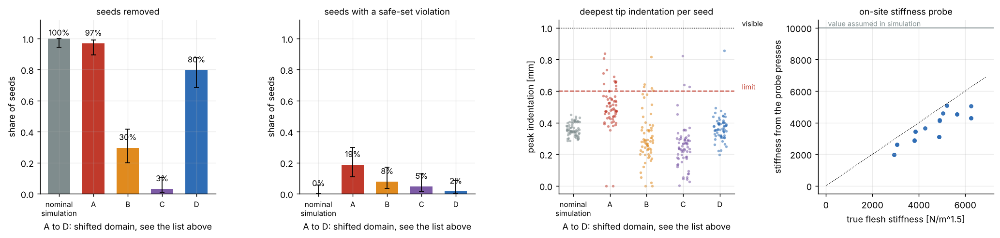

| condition | seeds | removed | any violation | indent | force | shear | squeeze | slip | visible damage | time / seed [s] | attempts |
|---|---|---|---|---|---|---|---|---|---|---|---|
| nominal simulation (reference) | 64 | 100% | 0% | 0% | 0% | 0% | 0% | 0% | 0 | 7.4 | 1.02 |
| A: simulation calibration only | 64 | 97% | 19% | 19% | 0% | 0% | 0% | 0% | 0 | 7.7 | 1.12 |
| B: + noise and stiffness probes | 64 | 30% | 8% | 8% | 3% | 3% | 0% | 0% | 0 | 18.7 | 1.81 |
| C: + surface re-referencing | 64 | 3% | 5% | 5% | 3% | 3% | 0% | 0% | 0 | 21.6 | 2.00 |
| D: + new conformal bounds | 64 | 80% | 2% | 2% | 2% | 2% | 0% | 0% | 0 | 8.4 | 1.44 |

| bound (90% coverage) | from the nominal simulation | recalibrated in the shifted domain |
|---|---|---|
| surface height before touch [mm] | 0.666 | 0.163 |
| indentation after touch [mm] | 0.101 | -0.049 |
| seed position, sideways [mm] | 0.444 | 0.530 |
| tip force [N] | 0.049 | 0.078 |
| jaw squeeze [N] | 0.078 | 0.136 |

Results: reference in the nominal simulation: 100% removed, 0% with a violation, 7.4 s per seed (64 seeds). A: 97% removed, 19% with a violation, 7.7 s per seed. B: 30% removed, 8% with a violation, 18.7 s per seed. C: 3% removed, 5% with a violation, 21.6 s per seed.
D: 80% removed, 2% with a violation, 8.4 s per seed.

Reading the results:

- **A** removes almost everything (97%) but breaks the indentation limit on 19% of the seeds
  (deepest press 0.84 mm, limit 0.6 mm). The fruit is softer than the robot believes, so
  the same force means a deeper press and touch is felt later.
- **B** has fewer violations (8%) but removes only 30%. In the 45 missed seeds the
  tips went 0.25 mm deep (median); in the 19 gripped ones
  0.39 mm. The tips stayed too shallow to grip, and after two attempts the
  planner gave up. The likely reason is the filter's indentation bound: on soft fruit the
  measured force says little about depth, so the filter depends on the surface-height bound,
  and that bound is wide.
- **C** does not help by itself (3% removed, 5% with a violation). The surface estimate
  is corrected, but the filter still uses the bounds from the simulation.
- **D** changes only the bounds compared with C. The surface-height bound, now measured after
  re-referencing, is 0.16 mm instead of 0.67 mm. The force and
  squeeze bounds grow (force 0.049 N to 0.078 N, squeeze 0.078 N to
  0.136 N); the sensors are noisier in the shifted domain. Result: 80% removed,
  2% with a violation (1 of 64 seeds, deepest press 0.86 mm), 8.4 s
  per seed.

The comparison of C and D shows that the bounds were what blocked the robot. Which bound
mattered most was not separated. The sideways bound also grew, and it widens the jaw opening,
which by itself reduces misses.

So the simulation-calibrated safe set did not transfer as it was. It transferred after an
on-site calibration with four parts: force-noise check, stiffness probe, surface
re-referencing and new conformal bounds. Even then the result (80% removed) is below the
nominal simulation (100%).

Cautions:

- **The probe itself touches the fruit.** Over 40 probed berries the probe presses went
  0.49 mm deep (median) and at most 0.64 mm; on 10% of the
  berries they went past the 0.6 mm limit. The fitted stiffness was off by 19%
  (median).
- **The new bounds rest on little data.** They come from 4 berries (32 seeds;
  22 for indentation and 12 for squeeze), collected while the robot
  was still missing most seeds. The indentation bound came out slightly negative
  (-0.05 mm), which means the robot's indentation estimate was above the truth
  in at least 90% of those cases.
- **The one violation in D was a deep one** (0.86 mm).
- **Simulation against simulation.** A real sim-to-real gap has effects that are not modelled
  here (see the limits below).

---

## Step 9. Demo

`demo/seed_removal_demo.mp4` shows the filtered system removing six seeds from one berry, with
live gauges for indentation, tip force and jaw squeeze against their limits. Key frames:

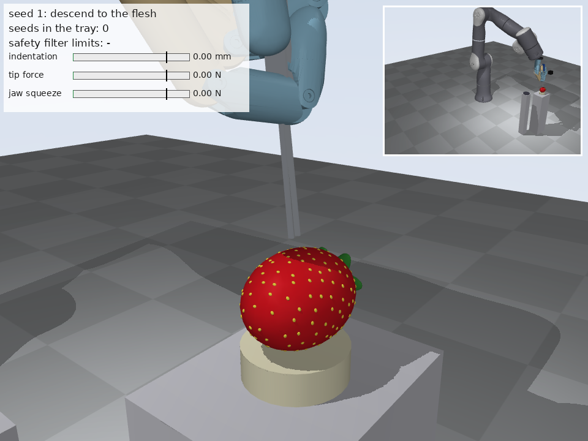
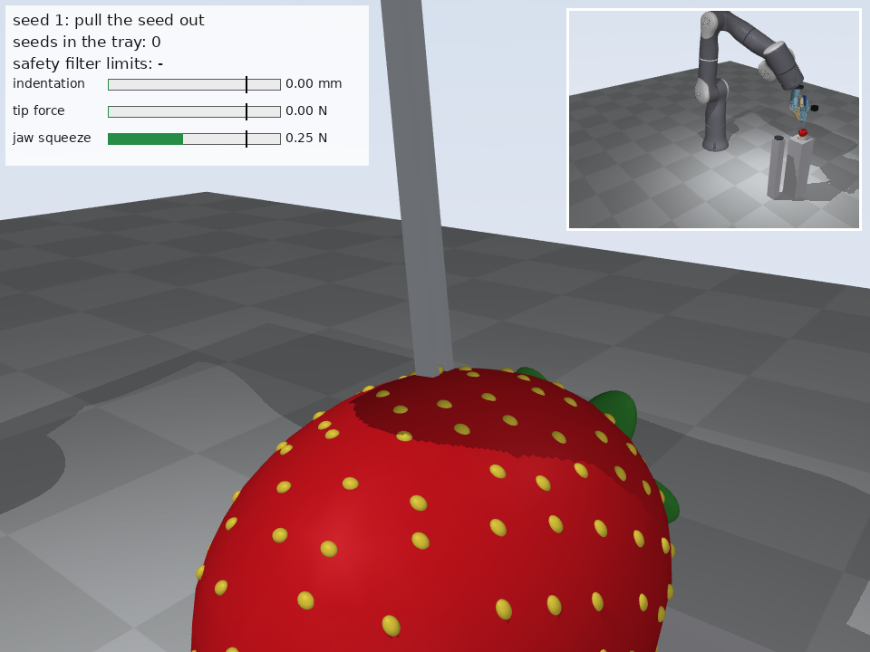

Reproduce: `python scripts/make_demo.py`

## Step 10. Tests, and running on the laptop

`python -m pytest -q tests` runs 12 tests: the QP solver against brute force, conformal
coverage, the berry geometry, iLQR, the reachable-set boundary, the tweezer calibration, "the
filter stops a deep press", and a short filtered run that must remove seeds with no violation.

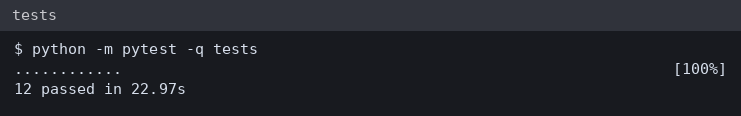

The same tests were also run on the team laptop in the Linux environment that the assistant can
use there (Python 3.10, MuJoCo 3.17, no GPU rendering): 12 passed. The experiments and the
video were produced on a cloud machine (Python 3.13, MuJoCo 4.0) and copied to the repository.

---

## Limits and what is simplified

- **No hardware.** No real arm, hand, tweezers or fruit were used. The arm model is a Rizon 4,
  not an Enlight. The hand model is the public Wuji Hand description from the maker; it was
  not checked against the second-generation hardware.
- **Fruit model.** The berry is a rigid ellipsoid on a soft cradle. Deformation exists only as
  the contact law at the two tips. There is no finite-element flesh, no pits, no tearing.
  Stiffness, pull-out force and damage limits are plausible guesses, not measurements.
- **Sleeve grip.** The sleeve is held by a friction-limited seat, not by simulated finger
  contacts. Thumb and index contacts are simulated.
- **Sensing.** Tip force comes from joint torques with white noise and a slow bias; real torque
  sensing has friction and model errors that are not simulated. The noise level assumed here
  (about 0.01 N at the tip after filtering) is optimistic.
- **Human operator.** A model with delay, noise and depth error. No person took part.
  `scripts/teleop_keyboard.py` is ready for real trials but was not tested with a display.
- **Open questions in the results.** Three things were observed and not explained: why the
  jaws did not close on the seed when a person steers everything behind the filter (E3), which
  of the recalibrated bounds restored seed removal in the shifted domain (E4), and the few
  violations that the filter did not prevent (1 of 64 in E1b, 4 of 64 in E3, 1 of 64 in E4 D).
- **Statistics.** Each condition was run once. 64 seeds per condition. Rates near 0% or 100% have 95% intervals of about
  0 to 6%.
- **Conformal bounds.** Calibration scores were collected with one filter setting; changing the
  margins changes the robot's behaviour a little, so the coverage guarantee is approximate.
  Seeds on the same berry share errors and are not fully independent.

## Glossary (English / 中文)

| Term | 中文 | Meaning here |
|---|---|---|
| achene | 瘦果 | the "seed" on the outside of a strawberry |
| end-effector | 末端执行器 | what the arm carries: here the hand with tweezers |
| degrees of freedom (DoF) | 自由度 | number of independent joints |
| forward kinematics | 正运动学 | computing where the tip is from the joint angles |
| Jacobian | 雅可比矩阵 | maps joint speeds to tip speed, and tip force to joint torques |
| indentation | 压入深度 | how far a tip is pressed into the flesh |
| safe set | 安全集 | all states in which every damage limit holds |
| safety filter | 安全滤波器 | module that changes a command as little as possible to stay in the safe set |
| control barrier function (CBF) | 控制屏障函数 | a function that is positive inside the safe set; the filter keeps it from decreasing too fast |
| quadratic program (QP) | 二次规划 | small optimization problem solved by the filter every 5 ms |
| reachability / reachable set | 可达性 / 可达集 | the states from which a failure can no longer be avoided (or can still be avoided) |
| model predictive control (MPC) | 模型预测控制 | plan a short time ahead, execute the first step, plan again |
| iterative LQR (iLQR) | 迭代线性二次型调节器 | the optimizer used inside the MPC |
| nominal planner | 名义规划器 | the planner that pursues the task and ignores the safe set |
| conformal prediction | 保形预测 | turns calibration errors into bounds with a coverage guarantee |
| coverage | 覆盖率 | share of new cases in which the bound holds |
| hand-eye calibration | 手眼标定 | where the camera sits relative to the robot |
| shared autonomy / shared control | 共享自主 / 共享控制 | person and robot command the motion together |
| teleoperation | 遥操作 | a person steers the robot directly |
| sim-to-real gap | 仿真到现实差距 | what works in simulation may behave differently on hardware |
| Hertz contact | 赫兹接触 | contact law in which force grows with depth to the power 1.5 |
| tare | 去皮 / 清零 | setting the force reading to zero in free space |
| back-drivable | 可反向驱动 | a joint that outside forces can move, so its torque can be sensed |

Last test run: `12 passed in 22.97s`
